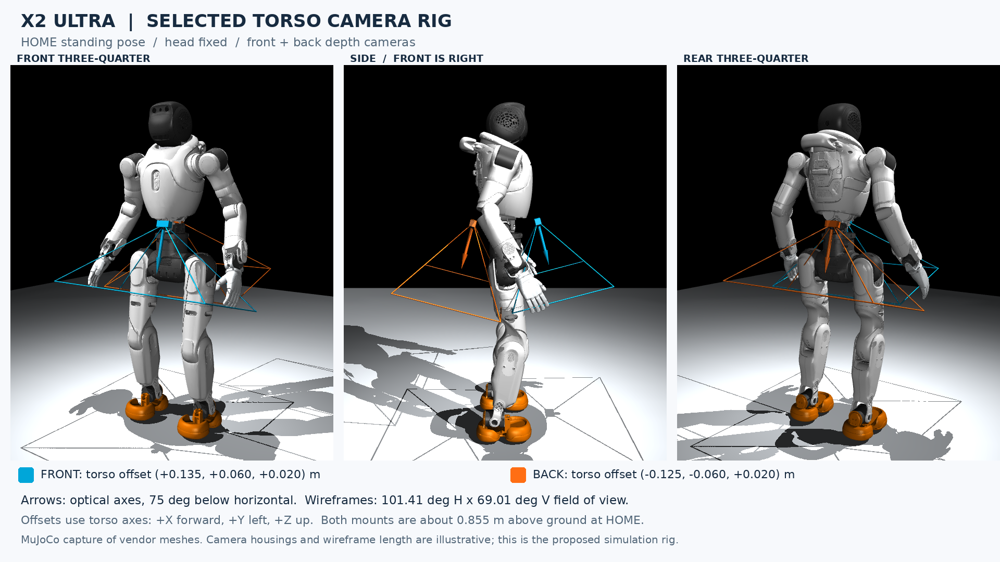

# Agibot X2 Ultra runtime integration

X2 runtime integration is implemented for IsaacGym training and MuJoCo sim2sim. Portable head-fixed assets, robot/experiment presets, the dual-camera rig, inference presets and a four-GPU launcher are included. Short local smoke checkpoints are integration artifacts; they are not trained locomotion policies. Full training has not been launched.

Hardware communication and real-robot deployment remain outside this scope. Unitree HG messages are used as a local simulation transport on loopback, not as an Agibot hardware interface.

## Robot and training configuration

The selected robot has 29 actions: 12 leg + 3 waist joints in the lower body and 14 arm joints in the upper body. Head yaw and pitch are fixed at zero with head mass and inertia preserved. PD gains use `agibot_stiff`, and initial/default joint positions use `HOME_KEYFRAME`, both from the previously selected constants file. No other values are adopted from that file.

The [parameter reference](x2_ultra_parameters.md) and [JSON](x2_ultra_parameters.json) contain ordered gains, limits, HOME, inertias, geometry and camera transforms. Runtime constants load the packaged snapshot under `rpl_training/data/robots/x2`, so training on another machine does not require either original absolute source path.

| Configuration | Relationship to G1 |
| --- | --- |
| PPO/DAgger networks, learning rates, rollout length, minibatches and iterations | Inherited from corresponding G1 presets; no X2 PPO loss or optimizer override |
| Terrain-expert reward weights, terrain distributions and domain randomization | Inherited from corresponding G1 presets; end-effector acceleration rewards select X2 wrist-roll end links |
| Environment allocation | G1 global totals retained: stones/stairs/generic expert 16,384; slopes 4,096; depth student 8,192 |
| Physics / policy frequency | Preserved at 200 Hz / 50 Hz; PD torques recomputed each physics step |
| Torso/base-height commands | Same task interpretation and curriculum; nominal height changed to 0.68 m |
| Robot dynamics and geometry | X2 vendor parameters with a symmetric simulation waist-yaw range, simplified collisions, per-joint armature 0.03, joint friction 0.3, selected gains/HOME and derived foot samples |
| Upper-body references | Fixed HOME arms (`motion=None`); G1 joint-space clips are not reused |
| Hand forces and interactive hand IK | Disabled for this baseline |
| Symmetry augmentation | Enabled for flat/expert PPO with G1 coefficients (actor 1, critic 0); depth DAgger unchanged |
| Episode horizon | Explicit 10 s, matching G1's standardized motion duration without requiring a motion library |

The fixed-reference terrain curriculum uses the episode horizon when no motion library is active; otherwise its move-down criterion would see a zero-duration clip. G1 motion-enabled behavior is preserved.

Despite the name `waist_pitch`, RPL tracks desired torso tilt through projected gravity. Hip/leg and pelvis motion can compensate for limited waist travel. Torso pitch commands retain the G1 range and are not clamped to waist-pitch joint limits. Yaw separately tracks the waist-yaw joint.

## Joint order

X2 retains its native vendor order throughout IsaacGym, observations, lower/upper actor outputs, ONNX metadata, DDS motor arrays and MuJoCo. G1 joint vectors must not be substituted by index. Legs and shoulder/elbow ordering match G1; these zero-based indices differ:

| Indices | G1 | X2 |
| --- | --- | --- |
| 12–14 | waist yaw, roll, pitch | waist yaw, pitch, roll |
| 19–21 | left wrist roll, pitch, yaw | left wrist yaw, pitch, roll |
| 26–28 | right wrist roll, pitch, yaw | right wrist yaw, pitch, roll |

The lower actor covers indices 0–14 and the upper actor 15–28. Gains, HOME, limits and symmetry signs are associated with X2 joint names. The MuJoCo bridge resolves named state addresses and actuators explicitly. The G1 transport family selects the local message implementation and does not reorder X2 joints.

The task command vector deliberately remains **yaw, roll, pitch**, independent of X2's joint order. Its roll/pitch entries describe desired torso orientation; they are not copied into waist joint targets. Training rewards, command reflection and inference controls retain this semantic order. Changing command order to match the joint array would introduce an error.

Regression checks cover every joint with individual PD action/velocity inputs, axis-derived reflection signs, nonzero observation histories, named bridge states/commands, native IsaacGym limits and ordered export metadata.

## Symmetry and waist yaw

Keep the core learning algorithm unchanged. X2 uses the same PPO trainer, symmetry augmentation, action term and environment classes as the corresponding G1 preset. Symmetry coefficients remain actor 1 and critic 0. There is no X2 PPO loss override, reflection mask or additional distributed-loss guard. The X2 DAgger subclass only selects/validates teacher checkpoint compatibility; it does not change the distillation update.

The source vendor waist-yaw limits are `[-3.43, 2.2078]` rad. The asset generator applies symmetric **simulation hard stops** of `[-2.2078, 2.2078]` rad to the packaged URDF. MuJoCo is converted from this adapted URDF, and the runtime robot configuration uses the same override. Vendor source files and their original limits in the parameter reference remain unchanged. The standard 95% soft-limit fraction therefore gives `±2.09741` rad without an environment wrapper. Yaw commands retain G1's `±1` rad range.

Joint PD targets retain G1's behavior: there is no additional position-target clamp in training or inference. Narrowing the simulation articulation's hard stops is a model adaptation, not a PPO change. Vendor geometry/inertias retain their small left/right differences, so reflection remains approximate. The artificial negative-side hard stop must be removed for a later evaluation against original vendor limits before hardware deployment.

## Assets and cameras

The runtime URDF comes from the vendor simplified-collision URDF. Its MuJoCo counterpart is converted from that same file, with full-precision merged inertias written explicitly. This avoids dropping fixed-head mass during conversion. Both runtimes have 30 robot bodies and 29 articulated joints; MuJoCo has `nq=36`, `nv=35`, `nu=29`.

The vendor full URDF has 41 links, while the simplified URDF has 39 and omits the fixed `base_link` and `lidar_chest_front` frames. All required meshes and the vendor Mulan PSL v2 license are packaged. The alternate `x2_ultra_simplified.xml` and `x2_fist` variant are not runtime sources.



Blue marks the front camera and orange the back camera. The selected G1 training rig is attached to `torso_link`, near the lower torso, looking 75 degrees downward. Housings and frustum lengths are illustrative. Camera offsets, optical axes, FOV, 240×135 rendering, 48×27 images, 10 Hz capture and two-frame history follow the selected training configuration.

X2 self-occlusion meshes bake fixed-head/sensor transforms into retained bodies. MuJoCo uses the corresponding optical-frame conversion, two-frame image delay, clip-before-resize processing and antialiased bicubic resizing. The NumPy resize implementation is checked against training's Torch operation. Training camera noise and pose/FOV randomization are retained; MuJoCo evaluation uses the nominal rig. Full rendered scene parity across the two physics engines is not claimed.

At HOME, foot surfaces begin about 13.49 mm above flat ground. Joint PD alone does not balance the untrained floating robot. The interactive simulator therefore starts with a support band; release it with `9` when a suitable policy is running.

## Four-GPU full training

The target is **one machine with four GPUs**. Install the existing training environment on that machine as described in the repository README. The launcher defaults to one GPU for `TASK=flat` and `TASK=slopes`, and four GPUs for other stages. Flat ground follows the G1 repository default; terrain teachers follow the recorded G1 allocations. Multi-GPU jobs use the existing single-node `torchrun` path. Set `NGPUS` explicitly to override the stage default. `--training.num-envs` is the total across all GPUs. No four-GPU run was attempted on the current single-GPU computer.

```bash
# Optional flat-ground baseline: 1 GPU, 4096 environments.
TASK=flat bash rpl_training/training_runs/run_x2.sh --training.name x2-flat

# Train new X2 terrain experts; each command is a separate training job.
TASK=stones bash rpl_training/training_runs/run_x2.sh --training.name x2-stones
TASK=stairs bash rpl_training/training_runs/run_x2.sh --training.name x2-stairs
TASK=slopes bash rpl_training/training_runs/run_x2.sh --training.name x2-slopes
```

The target GPUs have the same stated 48 GB memory capacity as the reference L40S GPUs. Retain G1's global rollout size; the four-GPU student therefore has more environments per GPU than the eight-GPU reference:

| Stage | Reference G1 | X2 on the four-GPU machine | Global environments |
| --- | --- | --- | --- |
| Optional flat baseline | Repository default: 1 GPU × 4,096 | 1 GPU × 4,096 | 4,096, unchanged |
| Stones teacher | 4 GPUs × 4,096 | 4 GPUs × 4,096 | 16,384, unchanged |
| Stairs teacher | 4 GPUs × 4,096 | 4 GPUs × 4,096 | 16,384, unchanged |
| Slopes teacher | 1 GPU × 4,096 | 1 GPU × 4,096 | 4,096, unchanged |
| Dual-camera student | 8 GPUs × 1,024 | 4 GPUs × 2,048 | 8,192, unchanged |

Presets retain 50,000 expert iterations and 20,000 student iterations, as well as G1's learning rates, rollout lengths, epochs and minibatch counts. Global rollout batches and sampled transitions over the same iteration count are preserved. The student keeps 8,192 environments × 24 steps = 196,608 transitions per rollout. No gradient accumulation or automatic rollout-length/iteration scaling is added. W&B remains the default logger; use `LOGGER=disabled` for local logging. The student's per-GPU environment count doubles relative to the reference. Actual memory use and throughput still need measuring on the target machine; equal VRAM capacity alone does not establish either.

Prepare a teacher directory with one run directory per terrain key:

```text
/path/to/x2-teachers/
  slopes/RUN/model_XXXXX.pt
  stairs_up/RUN/model_XXXXX.pt
  stairs_down/RUN/model_XXXXX.pt
  stepping_stones_columns/RUN/model_XXXXX.pt
```

Use the slopes expert for `slopes`, stones for `stepping_stones_columns`, and explicitly supply the shared stairs expert for both stairs keys if training one policy for both directions. Local selection uses the latest lexicographically sorted run/checkpoint path; keep the directory unambiguous. Per-terrain W&B overrides from the G1 workflow are also supported. The X2 teacher loader validates checkpoint robot identity and joint order, and rejects G1 teachers.

```bash
TASK=distill bash rpl_training/training_runs/run_x2.sh \
  --training.name x2-depth \
  --algo.config.ckpt-teacher /path/to/x2-teachers
```

## Sim2sim

Start the simulator, then the corresponding policy in another terminal:

```bash
bash rpl_sim2sim/run_sim.sh --config rpl_sim2sim/config/x2_loco_manip_cam.yaml

# Flat export:
bash rpl_sim2sim/run_policy.sh inference:x2-29dof-rpl-flat \
  --task.model-path /absolute/path/to/flat/model_XXXXX.onnx \
  --task.velocity-input keyboard --task.state-input keyboard

# Or depth-student export:
bash rpl_sim2sim/run_policy.sh inference:x2-29dof-rpl-depth \
  --task.model-path /absolute/path/to/depth/model_XXXXX.onnx \
  --task.velocity-input keyboard --task.state-input keyboard
```

Use `i` to initialize, `]` to start the policy, and `9` in the MuJoCo window to release the support band. The depth policy consumes both shared-memory camera streams. X2 inference validates ONNX robot identity and joint order. G1 IK stays disabled automatically. The current C++ local transport uses DDS domain 0 on `lo`; use that domain for both simulator and policy.

Camera producer failures or missing frames stop physics and are propagated to the main process, including failures after the first successful frame. Shutdown joins workers and releases all renderers and shared memory even if a renderer fails to close. Stop an existing simulator before reusing its shared-memory name; duplicate producers are rejected.

The bridge maps joint names to state addresses and actuator IDs explicitly, handling both X2's 29 motors and the legacy G1 model's six extra floating-base actuators. The flat policy observes a base-height delta; terrain teachers and the depth student observe absolute commanded height, matching their respective training presets.

The bundled scene is flat ground. Held-out terrain courses and traversal evaluation remain subsequent work after training usable policies.

## Local smoke tests

Run the complete bounded suite on one GPU:

```bash
bash scripts/smoke_x2.sh
```

The suite runs regression tests, probes unrandomized IsaacGym mass/friction/names, trains flat/expert/depth models for three iterations each, checks PyTorch versus ONNX outputs, and launches actual simulator/policy processes over DDS and shared depth. Smoke runs use 32 environments and smaller terrain grids while preserving the terrain types. `ITERS` and `SMOKE_ENVS` override these test sizes. All smoke logging is local.

For the distillation test only, the suite assigns the short generic X2 expert checkpoint to all four terrain routes. These test teachers validate loading and optimization; replace them with trained X2 terrain experts for full training.

Logs and reports are written under `logs/x2-runtime-smoke/TIMESTAMP/`. The validation record is summarized in [runtime validation](x2_runtime_validation.md). Three-iteration checkpoints do not establish balance, command tracking, terrain traversal or sim-to-real readiness.

To regenerate assets after changing the parameter reference:

```bash
/home/ubuntu/.holosoma_deps/miniconda3/envs/rplmujoco/bin/python scripts/derive_x2_parameters.py
/home/ubuntu/.holosoma_deps/miniconda3/envs/rplmujoco/bin/python scripts/build_x2_assets.py
```

Only regeneration needs the original vendor files and gain/pose reference. The packaged assets support normal training and sim2sim independently of those local source paths.
